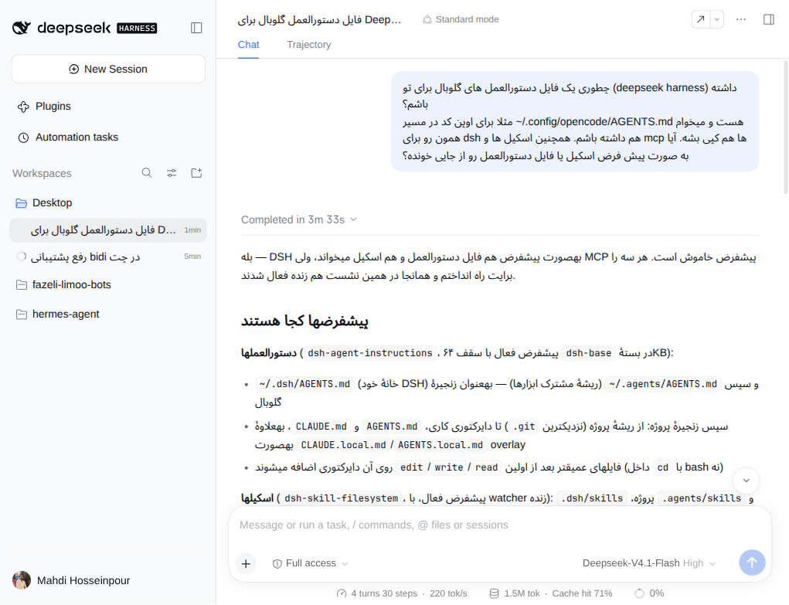
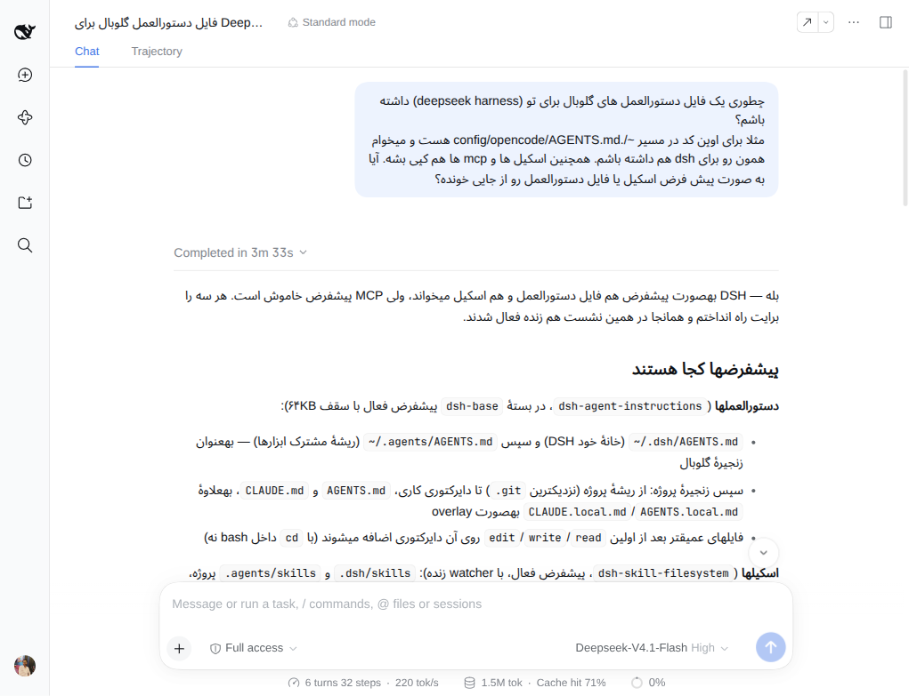
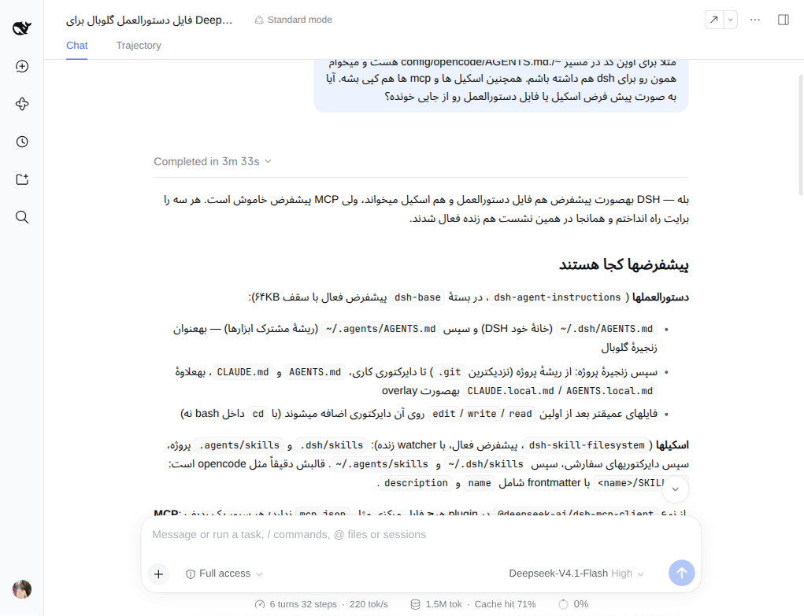
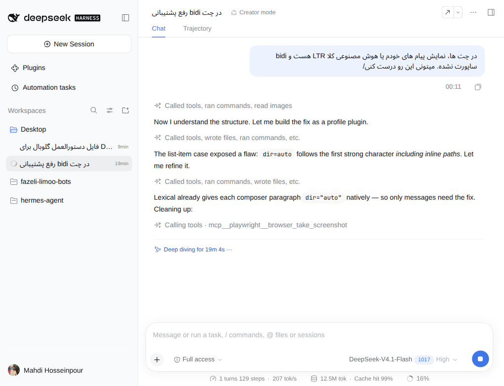
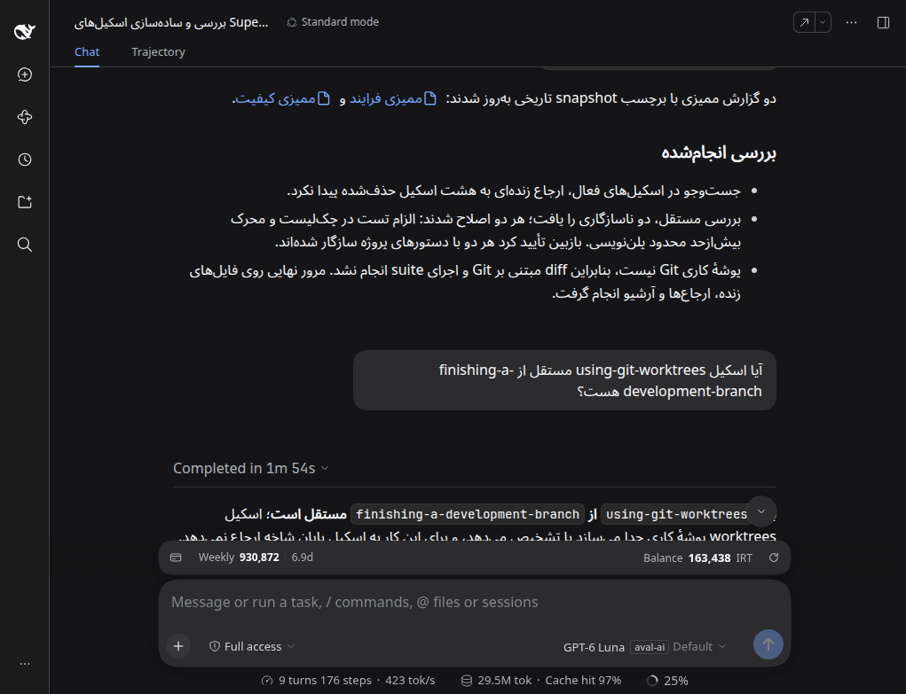
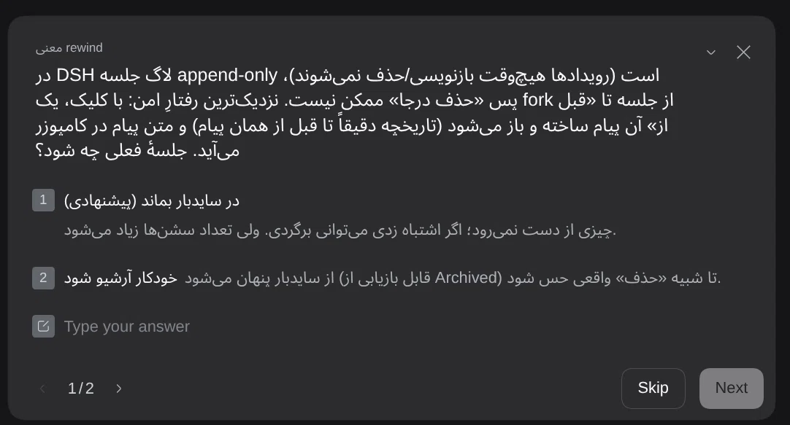
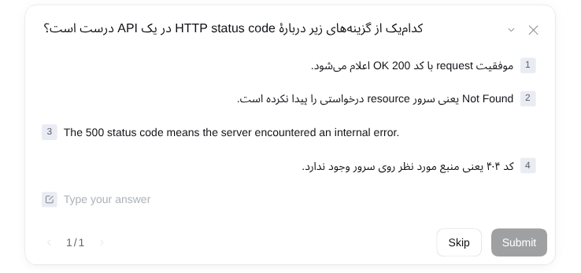
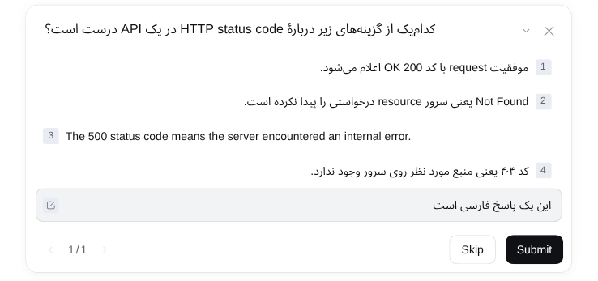
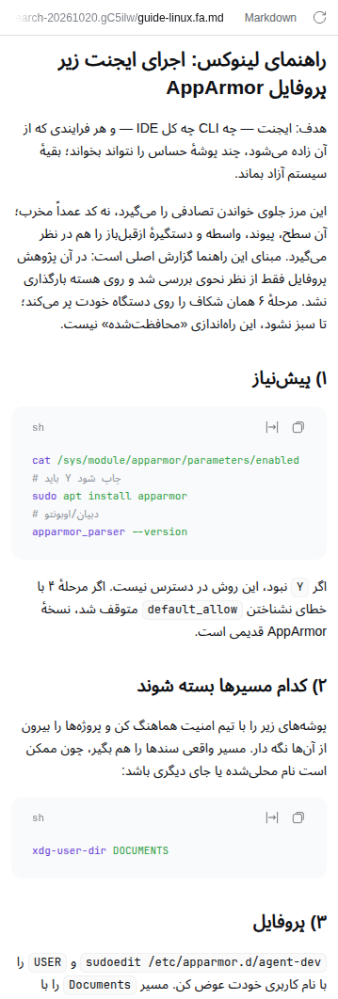

# Chat bidi layout

A small profile plugin for the DeepSeek Harness Web UI. It gives every block of
user-facing prose — in chat, in the agent's question card, in the right sidebar's
document preview — and every session or workspace name in the sidebar the text
direction of its own content, so Persian (or any right-to-left language) reads and
aligns correctly in a UI whose base direction is English/LTR.

## The problem

Chat messages and the agent's question card render inside an LTR context. The Unicode
bidi algorithm still orders the words correctly inside a Persian sentence, but the
paragraph keeps the LTR base direction, so:

- the paragraph is left-aligned and looks ragged on the left,
- a line's trailing punctuation lands on the wrong side,
- list markers stay on the left, away from the text they belong to.

The question card adds a second defect: its option buttons set `text-align: left`
explicitly, which `dir` alone cannot override.

The sidebar turns the same defect into a worse one. A session row is a single clipped
line, so an LTR cell starts a Persian name at the left, overflows to the right, and
cuts the **beginning** of the name — the part a reader needs first — behind the
ellipsis.

The document preview in the right sidebar repeats the chat defect: a Markdown file
written in Persian renders as left-aligned paragraphs with English-side list markers,
because the preview is outside every chat row and nothing in the page sets its base
direction.

## What the plugin does

For every prose block inside a chat message (`p`, `li`, `h1`–`h6`, `blockquote`, `ul`,
`ol`, tables, and the user's message bubble) it sets `dir="rtl"` or `dir="ltr"` from
the block's own words.

The direction is decided by **majority of words**, not by the first letter and not by
the majority of letters: a Persian sentence that begins with an English term (`Not
Found یعنی سرور آن منبع را پیدا نکرد`) is still a Persian sentence and aligns right.
A tie falls back to the first strong letter.

A word is a run of characters between spaces, so an identifier such as
`finishing-a-development-branch` is one word however long it is. That matters because
letters alone get the answer wrong as soon as the identifiers are long: the question
`آیا اسکیل using-git-worktrees مستقل از finishing-a-development-branch هست؟` is five
Persian words against two Latin ones, yet those two hold 44 Latin letters to 18
Persian. A letter count called that question English, so the bubble was left-aligned
and its line ran left-to-right — measured, that line read `اسکیل آیا
using-git-worktrees از مستقل finishing-a-development-branch`, every Persian pair in
the wrong order. With the word count the line runs right-to-left and reads
`آیا اسکیل … مستقل از …`, as written.

Inline code is ignored when deciding, so a Persian sentence that begins with
`~/.config/opencode/AGENTS.md` is still a Persian sentence and renders RTL.

Code spans and code blocks get an explicit `dir="ltr"` of their own instead. That
matters beyond alignment: the `dir` attribute also makes Chromium isolate the run, so
a path that starts with `~/.` is not reordered by the Persian text around it, and a
code fence inside a Persian list still starts at the left.

### Tables

A table is one block, not one per cell: the `<table>` takes the direction of its
**header row** — the column labels — and every cell inherits it. Per-cell directions
let a column's header and body disagree on their edge, because a mixed cell near
balance can fall either way, and they left the column order LTR.

The header row decides rather than the whole table because body values are a mix: in
the table this was checked on, the English phrases in the body were long enough to
outweigh its Persian labels, so a whole-table decision would have kept an otherwise
Persian table LTR. When a table has no header, or its header carries no letters at all
(numbers, icons), the whole table decides instead.

With one direction for the table, a column keeps a single alignment from header to
last row, and an RTL table orders its columns right-to-left, so the column described
first sits at the right. A table whose labels are English stays LTR and keeps its
column order, even when some body cells are Persian.

### The agent's question card

The card the agent asks with (`[data-question-key]`) is handled as a second surface:

- the question heading and its Markdown detail get the same content direction,
- each answer option gets the direction of its own text, and an RTL option also gets
  `text-align: start` because the host pins those buttons to `left`,
- the free-text answer field gets `dir="auto"`, so an empty field keeps the English
  placeholder left-aligned and typed Persian flips to right-aligned as you type —
  the same rule the composer already follows.

### The session sidebar

The Workspaces tree on the left is handled as a third surface:

- **Row labels** — session names and workspace folder names — take the direction of
  their own text. Right-aligning the label also moves the ellipsis to the left, where
  the end of an RTL name is cut.
- the **hover card** that opens over a row sets the same direction on its full title,
- the **session search field** gets `dir="auto"`, so the English placeholder stays
  left-aligned and a Persian query flips it as you type,
- **search results** — the session name and the workspace name in each row — follow
  their own content direction.

Only the label's text direction changes: the row's own chrome (leading status dot,
relative time, hover actions) keeps the side the host put it on.

Labels are located through the host's row key (`[data-row-key]`) and CSS-module class
names (`_title`, `_hoverTitle`, `_searchResultTitle`, `_searchResultWorkspace`); a
host rewrite of that markup would need this plugin updated.

### The document preview

The right sidebar's document preview (`[data-document-preview]`) is a fourth surface.
The host renders Markdown with the same primitives as the chat, so the chat rules carry
over:

- every rendered Markdown block — headings, paragraphs, list items, blockquotes, table,
  and the `dt`/`dd` pairs of a YAML frontmatter field list — takes the direction of its
  own text, and a table is decided once on the `<table>` from its header row,
- code spans and fenced code blocks get `dir="ltr"`, so a fence inside a Persian list
  still starts at the left,
- the plain-text fallback (`[data-textpreview-plain]`) has no blocks to hang a direction
  on: each preformatted line gets the direction of its own text, while the page's `pre`
  wrapper — which is a `pre` like a code block — is deliberately left alone,
- the code implementation (`[data-code-preview]`, a shiki code block) is code and stays
  LTR, the same as a fenced block in chat,
- the preview's own chrome — the path header, the format label, the wrap and refresh
  buttons — keeps the LTR base. A file path is not prose.

### Everything else

A `MutationObserver` applies the same rules to content that appears later — streaming
assistant text, paged-in history, new turns, a question card opening, options
re-rendering, a session row appearing or being renamed, a search result list replacing
the tree, a preview filling in as its file is read or rewritten — and recomputes a
block, label or preview line when its text changes. A `dir` the page itself sets is left
alone. Disabling the plugin removes every `dir` and every pinned `text-align` it added.

The composer needs no handling: Lexical already creates `dir="auto"` paragraphs.

## Screenshots

### Chat messages











### Question card







### Document preview



## Install

Requires DSH `^0.2.1-rc.5` on the `web` profile. From this repository's checkout,
open **Plugins** in the DSH Web sidebar, choose **Add plugin**, paste the absolute
path to this directory (`plugins/chat-bidi`), and choose **Install**.

Or, from an agent in Creator mode:

```
plugin_manager install_bundle target=<absolute path>/plugins/chat-bidi
```

The profile links the directory instead of copying it, so editing `client.js` and
reloading the page picks up the change, and disabling the row in **Plugins**
switches the behaviour off without touching the rest of the UI. Moving or renaming
the directory breaks the link — reinstall from the new path.

Two invariants keep the bundle loadable: the `id` passed to
`window.__ModuleLoader__.load` in `client.js` must equal the package name (the page
rejects a bundle that registers under another id), and the `name` in
`cordis.patch.yml` must equal it too. The directory name is arbitrary.

## Files

| File | Purpose |
| --- | --- |
| `client.js` | The browser half: direction detection, chat and question card, sidebar, document preview, observer. |
| `index.js` | Host half (empty — the bundle only needs the client module). |
| `cordis.patch.yml` | Inserts the `chat-bidi` row into the profile. |
| `locale/en.json`, `locale/fa.json` | Plugin Manager title and description. |
| `icon.svg` | Inventory artwork. |

## Known limits

- The conversation header's breadcrumb title (when the host renders one), tool cards,
  and the rest of the app chrome keep the LTR base.
- The rest of the app's layout is not mirrored — only text direction inside a block or
  a label. Option numbering, the question card's icon, and a sidebar row's dot, time
  and hover actions stay on the side the host put them on. A right-aligned RTL row
  title therefore sits beside the row's relative time, and slides left while the hover
  actions expand.
- A clipped RTL sidebar title does not run the host's hover marquee: that marquee
  scrolls the title in LTR coordinates, and the fade masks it paints on hover assume
  LTR edges. The text stays at its start and keeps the ellipsis on the left; the row's
  hover card shows the full name.
- Search-result snippets (the matched conversation text) are not labels and are left
  at the LTR base.
- Direction is decided per block, and for a table by its header row (or its whole
  content when it has no usable header). A block that mixes two languages follows the
  one with more words, so a line of Persian prose carrying a long English identifier
  stays RTL while a line that is mostly English stays LTR; a table follows its labels,
  so an English-labelled table stays LTR even with Persian cells in the body.
- A word decides by the majority of its own letters, and a word with no letters (a
  number, a lone arrow) does not count at all. A message that really is mostly English
  words — `using-git-worktrees چیست؟` is two Latin words to one Persian — stays LTR.
- Reasoning rows and other pre-formatted, non-`p` text inside a message are left as
  they are unless they use one of the handled block elements.
- Preview implementations that render outside the DOM the plugin can walk stay LTR: the
  HTML preview runs in its own iframe document, and the PDF, image, spreadsheet and
  Office previews are renderings rather than text blocks. Markdown and plain text are
  the previews whose direction this plugin decides; the code preview was already LTR
  and only gets that direction pinned.
- The verbatim source a frontmatter box shows while its field list loads is a `pre` and
  is therefore pinned LTR, like any code block; the field list that replaces it follows
  each value's own direction.

