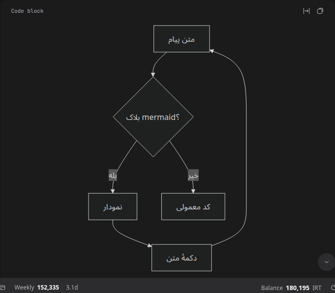

# Chat mermaid diagrams

A profile plugin for the DeepSeek Harness Web UI. A fenced ```` ```mermaid ```` block
inside a chat message is drawn as a diagram instead of source text, with the original
source one click away.



## What it does

- **Renders in place.** The code block keeps the host's banner (language label and
  Copy button); the code area is replaced by the diagram. Copy still copies the
  source, because the source element is hidden rather than removed.
- **Toggle.** A small footer button switches between the diagram and its source
  (`Source` / `Diagram`), so a diagram can be read and edited in the same place.
- **Theme aware.** The page's light/dark mode selects Mermaid's own light or dark
  theme; flipping the theme re-renders every open diagram. The SVG is transparent,
  so it sits on the host's code-card surface.
- **Safe fallback.** When Mermaid cannot parse the diagram, the source stays visible
  and a compact amber note appears once the text has settled: *Diagram could not be
  rendered* (the parse message is in its tooltip). Text that is still streaming is
  never reported as an error.
- **Localized.** UI strings and the inventory title/description come from `en` and
  `fa` dictionaries and follow the app language.

## How a mermaid block is recognised

The host only names a language it can syntax-highlight. Mermaid is not a Shiki
language, so its block is painted with the generic label **"Code block"** and the
fence name never reaches the DOM. Detection therefore works from the block itself:

1. the block must sit inside a chat row (`[data-slot="conversation.chat.node"]`),
2. its content must be **unhighlighted** (no `shiki` class on the `pre`),
3. and the first meaningful line must be a Mermaid directive — past YAML frontmatter
   and `%%` directives: `flowchart`, `graph`, `sequenceDiagram`, `classDiagram`,
   `stateDiagram`, `erDiagram`, `journey`, `gantt`, `pie`, `quadrantChart`,
   `requirementDiagram`, `gitGraph`, `mindmap`, `timeline`, `zenuml`, `sankey-beta`,
   `xychart-beta`, `block-beta`, `packet-beta`, `architecture-beta`, `radar-beta`,
   `treemap-beta`, `C4*` and `ishikawa-beta`.

A block the host did highlight is a real language and is never touched. The
trade-off of step 3 is deliberate: a fence labelled `text` (or with no label) whose
source starts with one of those directives is also drawn, and the `Source` toggle
brings it back. This is the only way to tell the two apart, because the label is not
in the DOM.

## Streaming, history and re-renders

A `MutationObserver` re-scans chat code blocks after DOM changes settle (250 ms). A
new or changed source is rendered again, and a cached render (up to 80 per theme) is
reused when the same diagram scrolls back into view. Because the scan re-reads every
block instead of trusting cached DOM, a React re-render of the message — streaming
text, paged-in history, a recycled row — repairs itself: the figure is moved back or
removed, and the host's own content is restored when the block stops being a
diagram.

## Install

Requires DSH `^0.2.1-rc.5` on the `web` profile. From this repository's checkout,
open **Plugins** in the DSH Web sidebar, choose **Add plugin**, paste the absolute
path to this directory (`plugins/chat-mermaid`), and choose **Install**.

Or, from an agent in Creator mode:

```
plugin_manager install_bundle target=<absolute path>/plugins/chat-mermaid
```

The profile links the directory instead of copying it: editing `client.js` and
reloading the page picks up the change, and the row can be switched off in
**Plugins** without touching anything else. Two invariants keep it loadable: the
`id` passed to `window.__ModuleLoader__.load` must equal the package name
(`dsh-chat-mermaid`), and so must the `name` in `cordis.patch.yml`.

## Files

| File | Purpose |
| --- | --- |
| `client.js` | Browser half: detection, mermaid rendering, toggle, theme/locale handling, observer, cleanup. |
| `index.js` | Host half: serves the vendored library to the page behind the owner check. |
| `vendor/mermaid.min.js` | Mermaid 11.17.2 UMD build (MIT) — see `vendor/NOTICE.md`. |
| `cordis.patch.yml` | Inserts the `chat-mermaid` row into the profile. |
| `locale/en.json`, `locale/fa.json` | Inventory title and description. |
| `icon.svg` | Inventory artwork. |
| `docs/*.png` | Screenshots above. |

## The library

Mermaid is shipped in the package rather than loaded from a CDN, so rendering works
offline and no page data leaves the machine. `index.js` registers the exact route
`/dsh-mermaid/mermaid.min.js`, admits owner connections through
`ctx.connection.admit`, and streams the file with `text/javascript`. The client loads
it lazily, the first time a diagram is actually rendered, and keeps one global copy
for the lifetime of the page.

## Verification

Checked in the running Web UI, not just by installation:

- a real chat message with a `mermaid` fence renders a diagram (light and dark), and
  the source is still the element the Copy button reads;
- the footer toggle switches diagram ⇄ source and back;
- a broken diagram leaves the source visible and shows the amber note, with the parse
  error in the tooltip;
- syntax-highlighted blocks (`js`) are untouched;
- a very tall diagram (18 nodes) renders at full height with no scroll container of
  its own: the diagram area reports `overflow: visible`, its `scrollHeight` equals
  its `clientHeight`, and the chat's scroller absorbs the height;
- disabling the row restores every code block, removes the inserted stylesheet and
  script, and re-enabling renders again;
- the Plugins row shows the localized title/description and the packaged icon.

## Known limits

- **Chat rows only.** The right sidebar's document preview and the agent's question
  card are different surfaces and are left alone; adding them is a small change to
  the row scope.
- **Host markup dependency.** Detection uses `.md-code-block`,
  `[data-code-block-banner]`, `[data-code-block-content]` and the `shiki` class. A
  host rewrite of the code-block component needs this plugin updated.
- **The banner still says "Code block".** The host never exposes the fence name for
  an unknown language; rewriting that label would mean editing React-owned text.
- **Tall diagrams make long messages.** A diagram renders at its natural height and
  the chat's own scroller handles the overflow. The plugin deliberately adds no
  second scrollbar of its own: a capped, self-scrolling diagram area showed up as a
  spurious scrollbar beside the chat's.
- **Label direction** is Mermaid's own rendering under the page's bidi rules. A
  mixed Persian/English label follows the browser's ordering; Mermaid directives can
  pin direction per diagram.
