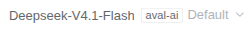
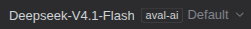

# Model provider label

A small profile plugin for the DeepSeek Harness Web UI. It shows which **provider**
the selected model comes from, as a separate tag beside the model name inside the
composer's model selector.

## The problem

Several providers can serve a model with the same display name. The composer's
selector showed only the model name (`Deepseek-V4.1-Flash`), so with, say, both
`aval-ai` and `aval-ai-s` in the directory there was no way to tell which provider
the current selection belonged to without opening the menu.

## What the plugin does

In the selector's trigger — the button that shows the selected model — the model name
is followed by a small bordered tag carrying the provider's display name:

```
Deepseek-V4.1-Flash  [aval-ai]
```




The tag is a separate element, not part of the model name: it keeps its own
styling and its own truncation. The model name keeps a minimum width, so the
provider can never squeeze it out; the tag gives way first and, in a narrow
composer (under 380px), is dropped altogether rather than collapsing to one
letter beside a truncated model name.

Menu rows and selectable options keep the plain catalog name: the options already
sit under a provider heading, and the root menu's current-value row is a compact
copy of the trigger.

## How it works

The composer declares an inline slot, `conversation.input.model.label`, whose owner
props carry `{ provider, model, placement, selected }`. The plugin registers a label
component that renders the provider tag only for `placement === 'trigger'`, and
returns the untouched catalog name everywhere else.

The slot is `single`, and the shipped `dsh-client-ui-deepseek-model-label-1017`
plugin already occupies it at the default priority 0. The registration therefore
passes `priority: -1` — the same shadowing mechanism the dynamic-client runner uses —
so this label wins the cell.

**Tradeoff:** winning this single cell replaces the shipped label in every
placement, so its `1017` release badge no longer renders anywhere it used to — the
trigger, the root menu's current-value row, and the official Flash option rows.
Disabling this plugin restores the shipped label and its badge unchanged (verified).
If the badge must stay while the provider tag is shown, the provider belongs in an
additive slot next to the selector (`conversation.input.activity` or
`conversation.input.right`) instead of inside it.

## Known limitation

The model button's accessible name and tooltip are set by the model-selection owner
and name only the model and the reasoning effort, so a screen reader does not
announce the provider even though it is visible. Changing that needs the owner's
caption (or a localized owner-side name), not this client slot.

## Install

Requires DSH `^0.2.1-rc.5` on the `web` profile. From this repository's checkout,
open **Plugins** in the DSH Web sidebar, choose **Add plugin**, paste the absolute
path to this directory (`plugins/model-provider-label`), and choose **Install**.

Or, from an agent in Creator mode:

```
plugin_manager install_bundle target=<absolute path>/plugins/model-provider-label
```

The bundle is a package with a `dsh.bundle.patch` row and a Client module; no build
step is involved. The profile symlinks the directory, so edits to `client.js` are
live after the plugin is reloaded.

## Verify

- The composer's model button shows the model name and the provider tag.
- Opening the model menu and picking a model from another provider updates the tag
  to that provider's name.
- The tag stays legible in light and dark themes (secondary label color, 11px).
- At a narrow composer (mobile width) the tag is hidden and the model name keeps
  the button's full width.
- Menu rows still list plain model names.
