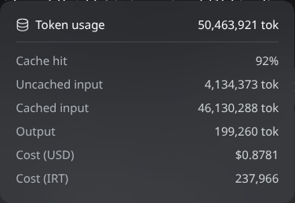

# Token Cost (USD + Toman)

Adds two lines to the composer's **token usage** popover: what the Session's
accumulated tokens cost in US dollars and in toman.

```
Token usage                    16,694,253
Cache hit                              92%
Uncached input                  1,277,487 tok
Cached input                   15,320,016 tok
Output                             96,750 tok
Cost (USD)                           $0.2956
Cost (IRT)                            80,117
```

## Where the numbers come from

- **Tokens** are the durable `tokenUsage` session projection — the same four
  buckets the popover already shows.
- **Model rates** come from AvalAI's public catalog, `GET /public/models`, in USD
  per one million tokens (`input`, `cached_input`, `cache_creation_input`,
  `output`). The catalog is cached in the Host for six hours.
- **USD cost** is `uncached input × input rate + cache reads × cached-input rate
  + cache writes × cache-creation rate (or the input rate) + output × output
  rate`.
- **Exchange rate** comes from `GET https://api.avalai.ir/public/exchange-rate`
  (`exchange_rate`, toman per 1 USD). It is read directly by the browser, which
  this endpoint allows (`access-control-allow-origin: *`), and cached in
  `localStorage` for one hour. The endpoint's `timestamp` is the response time,
  not the moment the rate changed, so the plugin times the cache itself.
- **Toman cost** is `USD cost × exchange_rate`, rounded to the nearest toman.

Both amounts are estimates. AvalAI's own `estimated_cost.irt` and this figure are
derived from the same rates, but neither is the final invoice amount.

The popover is a whole-session total, so a Session that switched models mid-log
is priced at the last route that produced tokens (the model selector normally
shows that route). For a provider that is not configured against an AvalAI host,
the plugin returns `applicable: false` and adds no rows. If the exchange rate
cannot be read, only the USD row is shown.



## Configuration

The bundle row in `cordis.patch.yml` accepts:

| Key | Default | Meaning |
| --- | --- | --- |
| `baseURL` | `https://api.avalai.ir` | Origin whose `/public/models` is read |
| `hosts` | `[api.avalai.ir]` | Provider hosts whose sessions get a cost row |
| `cacheSeconds` | `21600` | Model-catalog cache lifetime |
| `timeoutSeconds` | `12` | Model-catalog request timeout |

The exchange-rate cache lifetime is `RATE_TTL_MS` in `client.js` (one hour).
Opening the popover refreshes a rate that is older than that window; it does not
ask AvalAI on every look.

## How the rows are added

The shipped popover is a React-owned `<dl data-session-stats-usage>` with no
extension slot. The Client half registers an invisible seat in
`conversation.composer.dock`; that seat tracks the Session's `tokenUsage`
projection, asks the Host for the priced summary, and appends trailing
`<dt>/<dd>` pairs inside the popover while it is open. A MutationObserver
restores the pairs if the popover is closed and reopened, and teardown removes
them. React's own children are never modified.

## Requirements

- The Session's provider must be configured with an AvalAI `baseURL`.
- The model id must exist in the public catalog with an `input` and `output`
  rate; otherwise both rows stay hidden (`model-unpriced`).
- `api.avalai.ir/public/exchange-rate` must be reachable from the browser;
  without it the toman row is omitted.

## Install

Requires DSH `^0.2.1-rc.5` on the `web` profile. From this repository's checkout,
open **Plugins** in the DSH Web sidebar, choose **Add plugin**, paste the absolute
path to this directory (`plugins/token-cost`), and choose **Install**.

Or, from an agent in Creator mode:

```
plugin_manager install_bundle target=<absolute path>/plugins/token-cost
```

The profile links the directory instead of copying it; moving it breaks the link.

## Development

- Host: `index.js` (model-catalog cache, Session route + token projection,
  `/plugin/token-cost/summary`).
- Client: `client.js` (invisible dock seat, exchange-rate cache, DOM rows, locale).
- Verify syntax with `node --check index.js && node --check client.js`.
